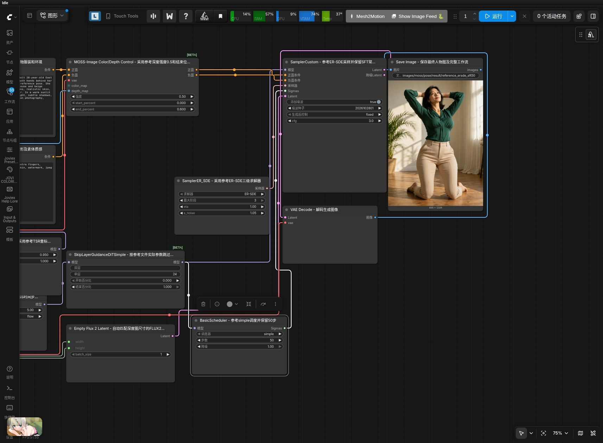
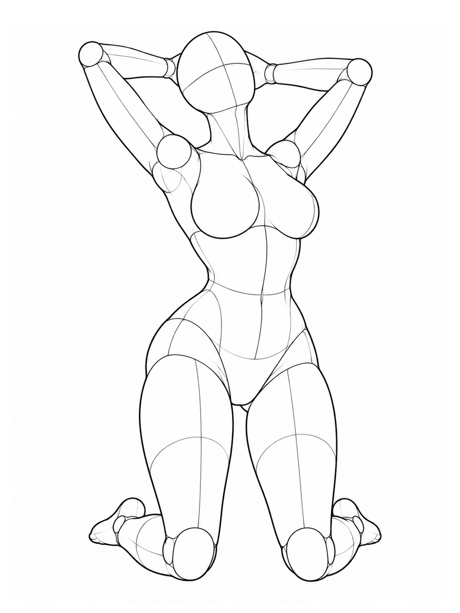
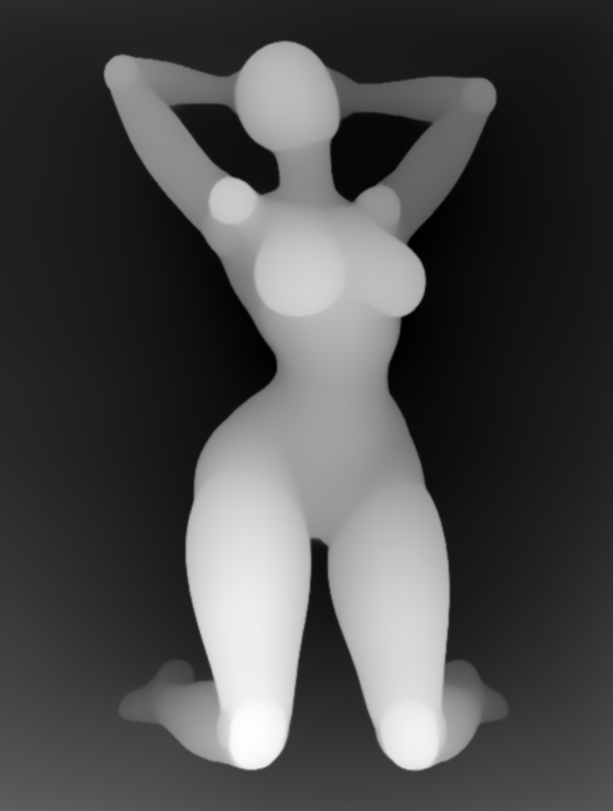
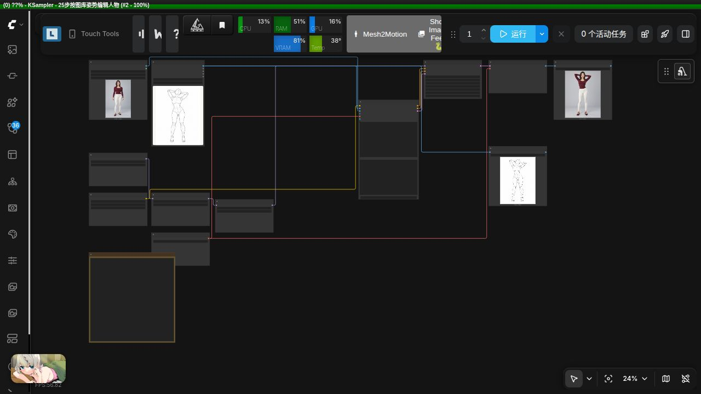
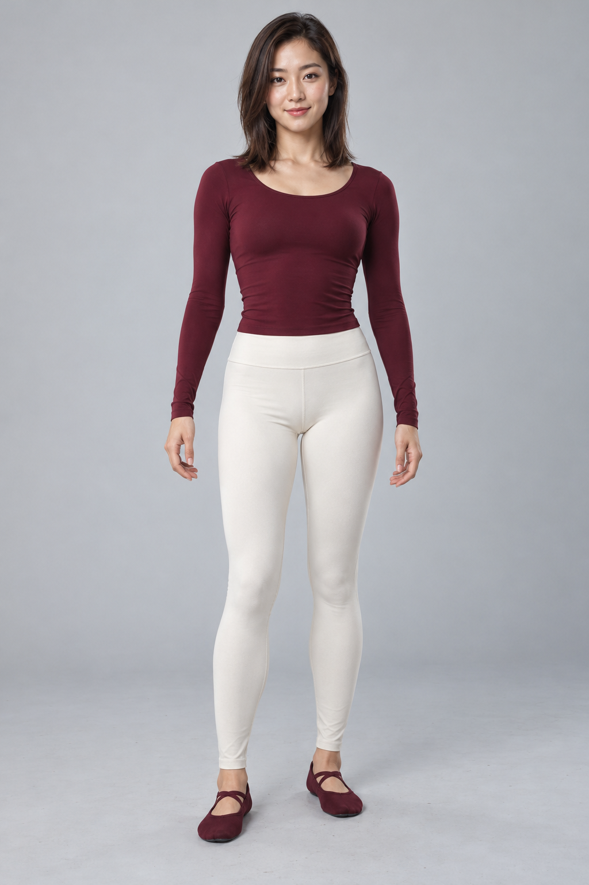
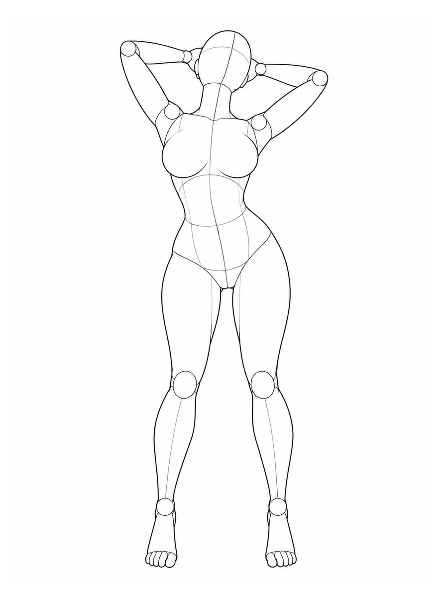
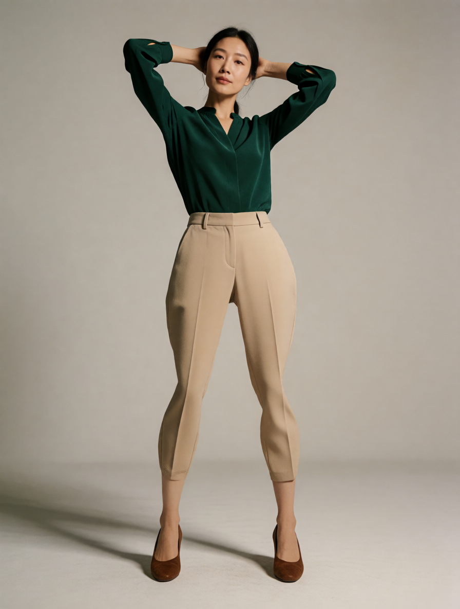

# comfyui-pose-gallery

ComfyUI 本地中文姿势图库节点。参考并改编 [ai-pose-gallery-zh](https://github.com/wangweihong/ai-pose-gallery-zh) 的画廊界面：1,439 张原图，288 组姿势，最多 5 个视角。

## 使用

添加 **image → Pose Gallery → Pose Gallery 姿势图库**，点击“浏览姿势图库”，按中文关键词、编号或 ID 搜索，使用体系、动作和视角筛选。点卡片进入大图，切换视角，点击“使用此姿势 → ComfyUI”。所选 ID 会保存在节点及工作流中，节点显示当前原图。

输出：`image`（RGB，900×1200）、`width`、`height`、`pose_id`、`description`。输出 `image` 可连接 Depth Anything、图像预览及其他图像节点。不自动入队；用户点击 ComfyUI“运行”开始生成。

## 工作流选择

| 工作流 | 输入与用途 | 本地实测 |
| --- | --- | --- |
| [MOSS 深度控制参考版](example_workflows/pose_gallery_moss_sft50_reference.json) | 图库姿势 → Depth Anything 深度图 → 根据文字生成角色 | SFT 50 步，ER-SDE，896×1184，约 46.4 秒 |
| [Qwen Image 2.1 姿态编辑](example_workflows/pose_gallery_qwen21_pose_edit.json) | 图库姿势 + 人物参考 → 保留人物外观并迁移姿态 | 25 步，Euler/simple，896×1184，约 17 秒/张（模型已加载） |
| [Krea2 深度控制](example_workflows/pose_gallery_krea2_depth.json) | 图库姿势 → Depth Anything V2 → Krea2 Turbo 深度控制文生图 | 8 步，ER-SDE，896×1184，热加载约 9.4 秒 |

下方提供实际 ComfyUI 截图及姿势与成图对照。运行时间受硬件、模型加载与缓存影响。

## 安装

在 `ComfyUI/custom_nodes` 目录执行：

```bash
git clone https://github.com/wangweihong/comfyui-pose-gallery.git
```

重启 ComfyUI 并刷新浏览器。仓库已直接包含 **1,439 张原尺寸 PNG、1,439 张 JPG 缩略图和中文索引**。克隆后即可离线浏览、预览原图，并将所选姿势输出给工作流，无需运行额外的素材下载脚本。完整素材约 660 MB。

```text
comfyui-pose-gallery/
└── library/
    ├── data/       # 中文姿势索引和分类
    ├── img/        # 1,439 张原尺寸 PNG，900×1200
    ├── thumbs/     # 1,439 张缩略图 JPG，300×400
    └── SOURCE.json # 素材来源和版本
```

### 已安装旧版：补齐原图

旧版仓库仅包含缩略图，可能出现“图库能浏览，但使用此姿势后节点不显示图片”。在节点目录更新即可：

```bash
cd ComfyUI/custom_nodes/comfyui-pose-gallery
git pull
```

更新后重启 ComfyUI，并强制刷新浏览器（Ctrl+Shift+R）。如果更新工具不会补齐素材，确认当前安装目录下存在 `library/img/`；不要只复制 `web/` 或缩略图目录。

若原图加载失败，节点会显示对应图片路径和更新提示，不再只显示空白。使用 `COMFYUI_POSE_GALLERY_LIBRARY` 时，该自定义目录也必须包含完整的 `data/`、`img/` 和 `thumbs/`。

`scripts/install_library.py` 保留用于手动修复或从已有的原图库 Git clone 复制素材，正常安装不需要执行它。

节点依赖均使用 ComfyUI 已有的 Pillow、NumPy、PyTorch、aiohttp。

高级：`COMFYUI_POSE_GALLERY_LIBRARY` 可指定服务器上已有的完整图库根目录（含 data、img、thumbs）；默认使用本插件 `library/`。浏览器只能读取元数据允许的图片，路径穿越和外部文件符号链接会被拒绝。

## Depth Anything → MOSS SFT 50 步

导入 `example_workflows/pose_gallery_moss_sft50.json`；`.api.json` 是服务端 API 格式。

链路：Pose Gallery → Depth Anything V2 Large → 1056×1408 等比缩放 → MOSS-Image Color/Depth Control → MOSS SFT → 保存。

工作流依赖：

- ComfyUI 0.43.0（本机已测试），含原生 MOSSImageControl、MOSS 模型支持。
- `comfyui_controlnet_aux`，Depth Anything V2 Large 权重。
- `models/diffusion_models/moss/moss_image_sft_bf16.safetensors`
- `models/text_encoders/moss/qwen3.5_9b_int8_convrot.safetensors`
- `models/vae/moss/flux2-vae.safetensors`
- `models/loras/moss/moss_image_color_depth_control.safetensors`，来自 [Comfy-Org/MOSS-Image](https://huggingface.co/Comfy-Org/MOSS-Image)，适配器作者 [darask0](https://huggingface.co/darask0/MOSS-Image-color-depth-control)。

50 步、CFG 3、Euler、sgm_uniform、Shift 5、负向跳过单流层 22。控制 LoRA 强度 1.0；深度强度 0.75，开始 0，结束 0.5。提前结束深度控制用于减少素体外观。深度输入采用近白远黑的灰度图。

切换姿势时，同时调整正向提示词中的动作；描述服装、脸部、环境和光线。深度图约束轮廓与前后关系，手指和脸部仍由模型生成。调整分辨率时，同时修改深度缩放和 Empty Flux 2 Latent 的尺寸。若想更严格约束，逐步调高 depth strength/end_percent。

运行保存路径相对于 **ComfyUI output**：

- `images/moss/pose/depth/pose_depth_*.png`
- `images/moss/pose/result/moss_sft50_pose_*.png`

PNG 包含实际 API 参数和可导入工作流。开发工作区的 `images/moss/pose/` 另外保留实测文件、历史和界面证据；这些本机文件不包含在此源码仓库中。

## 参考简化版 ER-SDE 工作流

导入 `example_workflows/pose_gallery_moss_sft50_reference.json` 使用参考版；对应的 `.api.json` 可通过 ComfyUI API 执行。该版本参考 `moss_image_control_depth_simple.json` 的采样配置，接入 Pose Gallery 和 Depth Anything，并使用常规 SFT 50 步。

- 参考文件的 101 号节点使用 `moss_image_color_depth_control.safetensors`，本机对应 `moss/moss_image_color_depth_control.safetensors`。
- 该 [Comfy-Org 文件](https://huggingface.co/Comfy-Org/MOSS-Image/blob/main/loras/moss_image_color_depth_control.safetensors) 与作者的 [moss-control.safetensors](https://huggingface.co/darask0/MOSS-Image-color-depth-control/blob/main/moss-control.safetensors) 字节一致，SHA-256 均为 `e5c0c3efd05e4269207a39de6005798f14c90c6687c89c54eaffe4b76c43a763`。
- 采用参考参数：ER-SDE、simple、TSR 0.95 / sigma 1、CFG 3、Shift 5、深度强度 0.5、控制范围 0–0.6。
- 参考文件 SLG 标题写着第 22 层，实际 `single_layers` 为 `24`；此版本明确采用实际数值 24。
- 参考文件外层为 24 步，本版保留用户要求的 50 步。主模型使用本机 SFT BF16；Turbo LoRA 不启用。
- 深度图按原比例缩放到约 1 MP，通过 GetImageSize 自动连接潜空间宽高；使用兼容 MOSS 的 EmptyFlux2LatentImage。
- 结果保存为 `images/moss/pose/depth/reference_depth_*.png` 和 `images/moss/pose/result/reference_ersde_sft50_*.png`（相对于 ComfyUI output）。

### MOSS 使用步骤与示例

1. 安装 `comfyui_controlnet_aux` 并准备上文模型。导入[ER-SDE 参考版工作流](example_workflows/pose_gallery_moss_sft50_reference.json)，在模型节点选择本机权重。
2. 在 Pose Gallery 浏览图库并点击“使用此姿势 → ComfyUI”，检查节点原图是否显示。
3. 修改正向提示词中的人物、服装、场景和动作，再运行。Depth Anything 自动从图库线稿生成深度图，MOSS 根据深度与文字生图。
4. 在 `output/images/moss/pose/depth/` 和 `output/images/moss/pose/result/` 查看深度图及成图。

以下为参考版 ER-SDE 50 步的实际运行截图；深度强度 0.5、控制范围 0–0.6，完整参数见上文。截图展示采样与输出区域，导入 JSON 可查看完整连线。



| 图库原图：P031 正面 | Depth Anything 深度图 | MOSS 生成结果 |
| --- | --- | --- |
|  |  |  |

姿势 ID：`full_sexy_P031_front`。示例人物穿绿色上衣与米色长裤，姿态为跪姿、双手置于脑后。深度约束整体轮廓，人物细节和背景由提示词生成。

## Qwen Image 2.1 · Pose Gallery 姿态编辑

导入 [`example_workflows/pose_gallery_qwen21_pose_edit.json`](example_workflows/pose_gallery_qwen21_pose_edit.json)，使用图库姿势原图与人物参考双图输入，配合 Qwen2.1 专用 Pose Studio v2 LoRA。通用提示词不含固定动作名称，已本地测试 P002 站姿与 P031 跪姿；25 步、CFG 1、Euler/simple，输出 896×1184。

导入前请查看[完整操作、模型依赖及实测结果](example_workflows/qwen21_pose_gallery.md)，复制附带人物参考图到 ComfyUI input，或选择自己的图片，并重选本机模型路径。该工作流使用 Pose Gallery 图库，不需要 VNCCS 3D 编辑节点。其他姿势效果需自行评估。

### Qwen 使用步骤与示例

1. 将[示例人物参考图](example_workflows/assets/pose_gallery_person_reference.png) 复制到 `ComfyUI/input/`，或直接在 Load Image 中选择自己的成人角色参考图。
2. 导入[Qwen 姿态编辑工作流](example_workflows/pose_gallery_qwen21_pose_edit.json)，按[模型依赖说明](example_workflows/qwen21_pose_gallery.md)选择 Qwen Image 2.1 BF16、Qwen3-VL 编码器、VAE 和 **QI2.1 专用 Pose Studio v2 LoRA**。
3. 在 Pose Gallery 选择姿势。图库原图连接编码器 `image_1`，人物参考连接 `image_2`。通用提示词保留人物身份、服装、画风、背景与光照，不含固定动作名称。
4. 点击运行，成图与姿势原图分别保存在 `output/images/qwen2.1/pose_gallery/results/` 和 `poses/`。

LoRA 强度 1，25 步、CFG 1、Euler/simple、种子 20261029，不叠加 Turbo LoRA。此链路直接使用图库线稿作为图像条件。



参考人物（下列两组测试共用）：



| 图库姿势原图 | Qwen Image 2.1 生成结果 |
| --- | --- |
|  |  |
|  |  |

两组结果分别对应 `full_sexy_P002_front` 和 `full_sexy_P031_front`，使用相同人物参考、同一份通用提示词，仅切换姿势 ID。保留了酒红色上衣、白裤和发型，同时由站姿切换为跪姿。其他复杂姿势及多人姿势尚未覆盖，仍可能需要补充文字、调整参数或重试。详细记录见[实测摘要](example_workflows/pose_gallery_qwen21_validation.json)。

## Krea2 · Pose Gallery 深度控制

导入 [Krea2 深度工作流](example_workflows/pose_gallery_krea2_depth.json)，或使用 [P002 站姿对照版](example_workflows/pose_gallery_krea2_depth_standing.json)。两份工作流均有同名 `.api.json`。链路为 Pose Gallery → Depth Anything V2 Large → Krea2 Control Image Encode / Apply → Krea2 Turbo；具体依赖、模型路径和操作步骤见[完整使用说明](example_workflows/krea2_pose_gallery.md)。

本地实测在相同提示词和种子下，仅切换图库姿势，分别生成对应跪姿与站姿。提示词只描述人物、服装、场景和画风，无需填写固定动作。896×1184、8 步、CFG 1、ER-SDE/simple、深度控制强度 1；首轮含模型冷加载约 67.8 秒，模型已加载后约 9.4 秒。它是文生图流程，人物由文字生成，没有人物身份参考图输入。

| 图库原图 | Krea2 生成结果 |
| --- | --- |
|  |  |
|  |  |

原图、深度图和成图分别保存在 `output/images/krea2/pose_gallery/poses/`、`depth/` 和 `results/`。目前只验证上述两组，手脚细节和精确关节角度仍可能偏离参考；详细记录见[实测摘要](example_workflows/pose_gallery_krea2_validation.json)。

## 素材和许可

节点代码及改编的画廊页面遵循 MIT；保留上游声明，详见 LICENSE、NOTICE.md。图片及原始数据权利属于原作者ギア，中文数据由 Anhao 整理，不适用代码 MIT 许可。仓库的 `library/img/`、`library/thumbs/` 和 `library/data/` 包含来自原图库的原尺寸图片、缩略图及中文索引，并保留素材来源和上游许可说明；这些素材不适用节点代码的 MIT 许可。原站链接和来源说明保留，已移除上游统计脚本。

## 验证

`python -m unittest discover -s tests -v` 检查目录边界、非法 ID、文件缺失和符号链接逃逸。本次还实际验证了 ComfyUI 注册、图库接口、浏览器搜索与视角切换、选择写回和完整 SFT 50 步生成。
