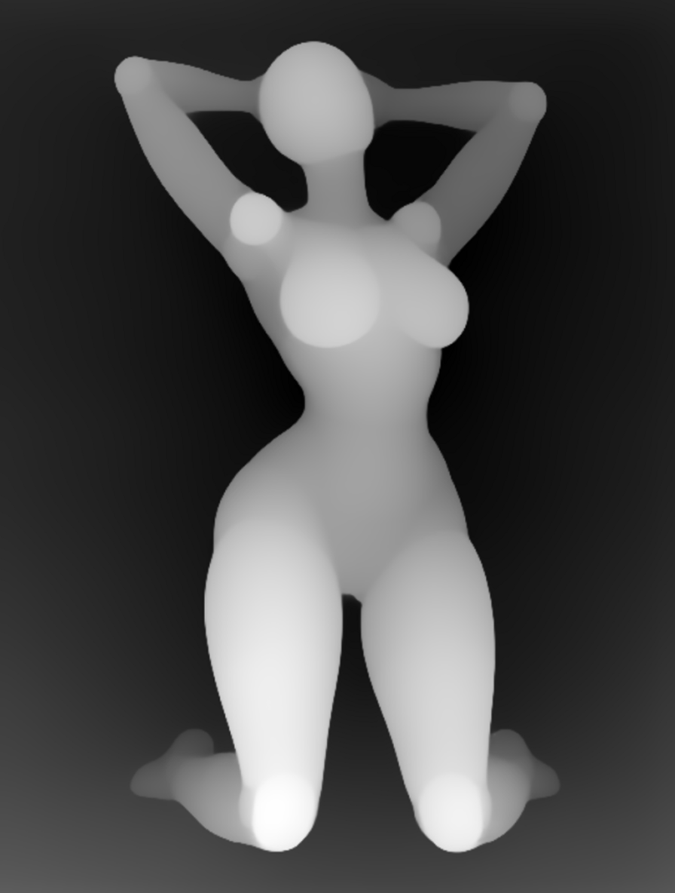
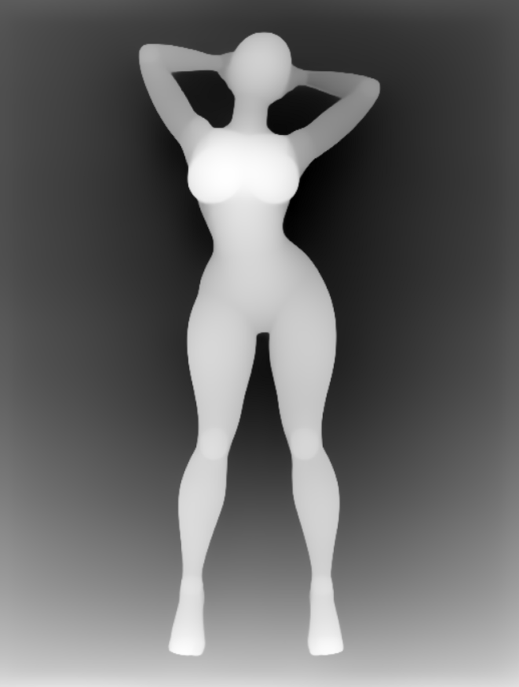

# Pose Gallery + Krea2 深度控制

导入 [`pose_gallery_krea2_depth.json`](pose_gallery_krea2_depth.json)（默认 P031 跪姿）。站姿对照是 [`pose_gallery_krea2_depth_standing.json`](pose_gallery_krea2_depth_standing.json)，两份工作流均附带同名 `.api.json`。

## 使用步骤

1. 安装下列自定义节点和模型。导入工作流，在模型节点中按本机目录重选权重；权重不包含在本仓库。
2. 在 Pose Gallery 浏览、搜索或筛选姿势，选择视角，点击“使用此姿势 → ComfyUI”，检查节点显示原图。
3. 在 CLIP Text Encode 中描述人物、服装、背景和画风。无需填写所选姿势的具体动作；示例提示词不含“站立”“跪姿”或“双手脑后”等动作。
4. 点击运行。Depth Anything V2 将图库线稿转成近白远黑的深度图；Krea2 专用深度 Control LoRA 根据深度条件生成。
5. 切换姿势后，可以修改三个 Save Image 节点的前缀以区分文件。分辨率由 Empty Latent Image 控制，深度图自动匹配潜空间尺寸。

这是深度条件文生图，人物外观由文字生成；没有接入人物身份参考图。需要保留已有角色身份时，可使用仓库中的 [Qwen 双图姿态编辑工作流](qwen21_pose_gallery.md)。

## 依赖与模型

- 支持原生 Krea2 和 `krea2` 编码器类型的 ComfyUI（本机版本 0.43.0）。
- 本插件 `comfyui-pose-gallery`。
- [comfyui_controlnet_aux](https://github.com/Fannovel16/comfyui_controlnet_aux)，提供 Depth Anything V2 预处理器。
- [comfyui-krea2-controlnet](https://github.com/facok/comfyui-krea2-controlnet)，提供 Krea2 Control LoRA Loader、Krea2 Control Image Encode、Krea2 Control Apply。

下表为工作流在模型下拉框中的值；相对于各模型类型目录，其他机器安装位置可以不同。

| 模型节点 | 工作流中的选择值 | 放置目录（相对于 ComfyUI） |
| --- | --- | --- |
| Load Diffusion Model | `diffusion_models/krea2_turbo_bf16.safetensors` | `models/diffusion_models/` |
| Load CLIP | `qwen3vl_4b_fp8_scaled.safetensors`，类型 `krea2` | `models/text_encoders/` |
| Load VAE | `qwen_image_vae.safetensors` | `models/vae/` |
| Krea2 Control LoRA Loader | `text2image/krea2/depth-control-lora.safetensors` | `models/loras/` |
| Depth Anything V2 | `depth_anything_v2_vitl.pth` | `custom_nodes/comfyui_controlnet_aux/ckpts/depth-anything/Depth-Anything-V2-Large/` |

本机主模型在 `models/diffusion_models/diffusion_models/` 下，LoRA 在 `models/loras/text2image/krea2/` 下，因此选择值带这些子目录。常规安装可使用自己的路径，导入后重选即可。

权重来源：[Krea2 模型](https://huggingface.co/Comfy-Org/Krea-2)、[Qwen3-VL 编码器](https://huggingface.co/Comfy-Org/Qwen3-VL)、[Qwen VAE](https://huggingface.co/Comfy-Org/Qwen-Image_ComfyUI)、[Krea2 深度控制 LoRA](https://huggingface.co/Patil/Krea-2-depth-controlnet)。

不要将深度 LoRA 接收的控制图直接替换成原始线稿；当前工作流先转换为深度图。Krea2 Control Apply 必须接在控制 LoRA 后面。

## 参数与保存位置

- Krea2 Turbo BF16，896×1184，8 步，CFG 1，ER-SDE / simple，denoise 1，种子 20261029。
- 深度 LoRA 强度 1；Depth Anything V2 Large 预处理分辨率 768。
- 控制编码：match_latent_size、bicubic、center、rgb、per_image_minmax、invert=false、independent_images。
- 原图：`output/images/krea2/pose_gallery/poses/`。
- 实际编码的深度图：`output/images/krea2/pose_gallery/depth/`。
- 生成图：`output/images/krea2/pose_gallery/results/`。

## 本地实测

2026-10-29 使用相同人物提示词、相同种子，仅切换图库姿势，完成两组测试。

| 姿势 | 执行耗时（不含队列等待） | 目视结果 |
| --- | ---: | --- |
| `full_sexy_P031_front` | 67.765 秒（含模型冷加载） | 双膝跪地、双手脑后的整体动作跟随；脚部位置存在差异 |
| `full_sexy_P002_front` | 9.416 秒（模型已加载） | 站立、双手脑后的整体动作跟随；身体角度存在细微差异 |

| 图库姿势 | Depth Anything 深度图 | Krea2 结果 |
| --- | --- | --- |
|  |  |  |
|  |  |  |

执行摘要见 [`pose_gallery_krea2_validation.json`](pose_gallery_krea2_validation.json)。这两组结果验证了图库姿势可通过深度控制用于 Krea2；未测试完整图库，手脚细节、遮挡和精确关节角度仍可能偏离。示例成图为本地 AI 生成；图库图片许可见仓库 NOTICE.md。
