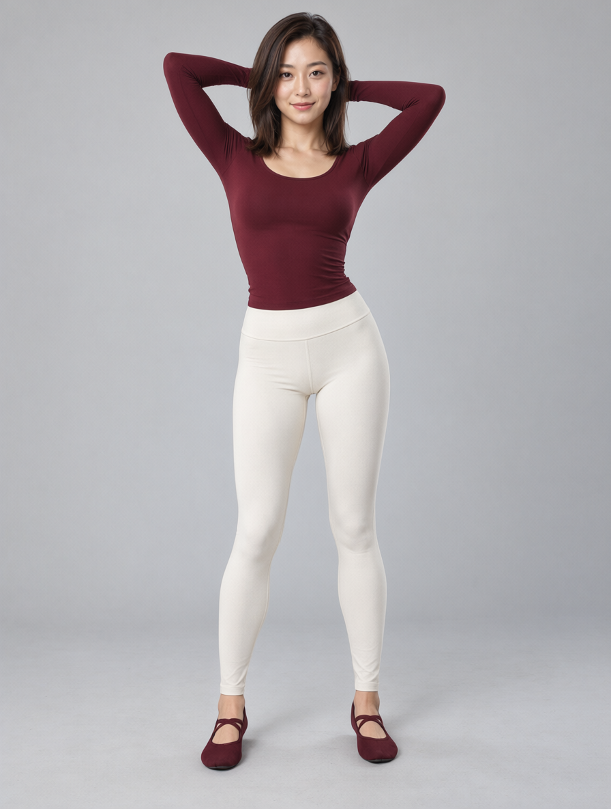
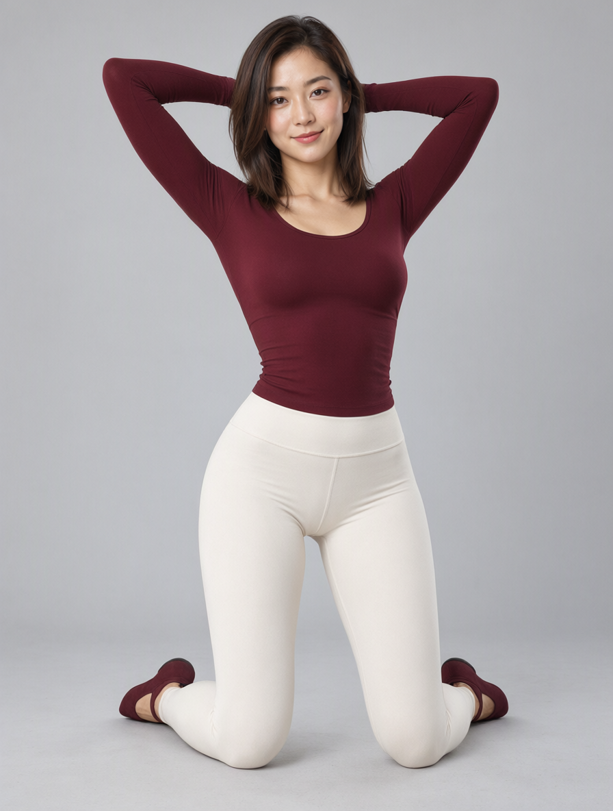

# Pose Gallery + Qwen Image 2.1 姿态编辑实测工作流

导入 [`pose_gallery_qwen21_pose_edit.json`](pose_gallery_qwen21_pose_edit.json)；服务端 API 格式是同名 `.api.json`。

1. 将 [`assets/pose_gallery_person_reference.png`](assets/pose_gallery_person_reference.png) 复制到 `ComfyUI/input/`，或在 Load Image 中上传自己的成人角色参考图。
2. 检查下列模型路径并按本机实际目录重选。LoRA 应选 **Qwen Image 2.1 专用 v2**，不要使用 QIE2511 版本。
3. 在 Pose Gallery 中浏览、筛选姿势，选择视角，点击“使用此姿势 → ComfyUI”。节点应显示原图。
4. 点击运行。图库原图连接编码器 `image_1`，人物参考连接 `image_2`；不要交换顺序。

使用 Pose Gallery 节点与 ComfyUI 原生 Qwen Image 2.1 节点（本机 ComfyUI 0.43.0）。LoRA 是 [VNCCS Pose Studio QI2.1 v2](https://huggingface.co/MIUProject/VNCCS_PoseStudio_QI2.1) 适配器；本工作流不含 VNCCS 3D 编辑节点，无需安装该扩展。权重不包含在本仓库中。

| 模型 | 工作流中的本机路径 |
| --- | --- |
| Qwen Image 2.1 BF16 | `diffusion_models/image2image/qwen_image_2.1_bf16.safetensors` |
| Qwen3-VL 8B 编码器 | `text_encoders/text_encoders/qwen3vl_8b_bf16.safetensors` |
| Qwen Image 2.1 VAE | `vae/vae/qwen_image_2.1_vae_bf16.safetensors` |
| Pose Studio QI2.1 v2 LoRA | `loras/qwen2.1/动作编辑VNCCS_QI2_PoseStudioV2_3294845.safetensors` |

表中路径均相对于 `ComfyUI/models/`，嵌套目录是本机实际配置；其他安装可使用自己的目录及文件名，导入后在模型节点重选即可。

25 步、CFG 1、Euler/simple、denoise 1、种子 20261029，LoRA 强度 1，不叠加 Turbo LoRA。编码器 resolution 1024，按姿势图比例输出（本例 896×1184）。

## 通用提示词

Replace the pose of the person in image2 with the pose shown in image1. Use image1 only as a reference for body pose, limb placement, body orientation and camera viewpoint. Preserve the identity, facial features, hairstyle, clothing, accessories, colors, visual style, background and lighting of image2. Reproduce the reference pose as closely as possible with natural anatomy and coherent proportions. Render the person in the visual style of image2; do not copy the line drawing, mannequin appearance or annotations from image1.

提示词不含固定动作名称。切换姿势时可直接运行；复杂遮挡、多人、背身等情况仍可能需要补充文字和重试。

## 本地实测

2026-10-29 使用同一份通用提示词测试 `full_sexy_P002_front`（站姿）和 `full_sexy_P031_front`（跪姿），均生成相应的抬手和腿部姿态，并保留参考图的服装及发型。两个任务均成功完成，模型已加载时约17秒/张。未测试完整图库，不能保证所有姿势都能精确跟随。执行摘要见 [`pose_gallery_qwen21_validation.json`](pose_gallery_qwen21_validation.json)。

| P002 站姿 | P031 跪姿 |
| --- | --- |
|  |  |

示例参考人物与结果为本地 AI 生成图片，用于复现测试；图库姿势素材的许可见仓库 NOTICE.md。

保存目录相对于 ComfyUI output：`images/qwen2.1/pose_gallery/results/`（成图）与 `images/qwen2.1/pose_gallery/poses/`（姿势原图）。本链路直接使用图库线稿作为 Qwen 图像条件，不生成深度图；需要深度控制时使用仓库中的 MOSS 工作流。
